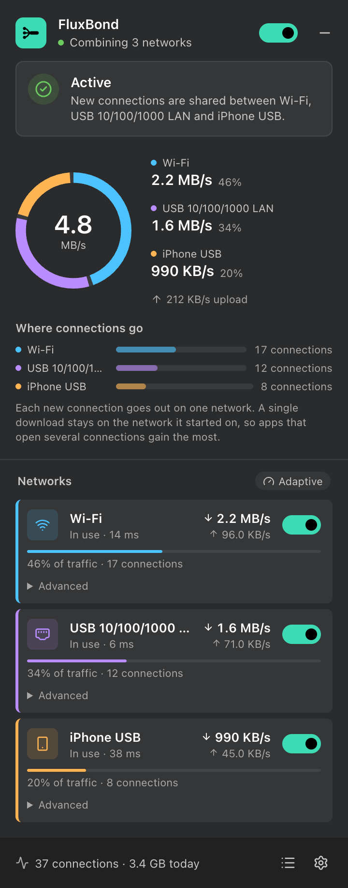
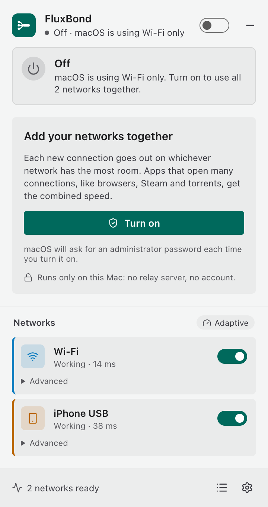

<div align="center">


# FluxBond

**Wi-Fi, Ethernet and your phone's connection, available together across your Mac.**

A small menu bar app for **macOS on Apple silicon**. It runs entirely on your Mac: no account, no relay server,
nothing in the cloud.

**Website:** https://timowse.github.io/mac-apps/apps/fluxbond/

<a href="https://github.com/timowse/FluxBond/releases/latest"></a>


[](LICENSE)

</div>

<p align="center">
  
  &nbsp;&nbsp;
  
</p>

## Why FluxBond

Most Macs have more than one way online — the office Wi-Fi, a USB Ethernet adapter, a phone with Personal Hotspot —
yet macOS only ever uses one of them at a time. FluxBond uses all of them together.

- **Independent networks, combined.** Each new connection goes out on the network with the most room left, so a
  browser, a download manager or a cloud backup gets the speed of all your networks at once.
- **macOS first.** A native `utun` adapter, routes and DNS through the system's own tools, a short-lived root helper
  for the password prompt, and a menu bar popup that follows light and dark mode.
- **Local, no account.** No sign-up, no server, no telemetry. Your traffic goes straight out through your own networks.
  The only thing FluxBond ever contacts by itself is the update feed, and only if you allow it.
- **Clear about what's happening.** The popup shows which network every connection uses, how much each one carries,
  and says in plain words when a network has no internet.

## What gets faster — and what doesn't

FluxBond balances **connections**. One connection always stays on one network, because splitting a single connection
would need a server on the internet.

| Gets faster ✅ | Doesn't get faster ❌ |
|---|---|
| Speed tests (fast.com, Speedtest) | A single download over one connection |
| Streaming sites that load video in chunks | One video call or game session |
| Download managers, Steam, torrents, cloud sync | |
| Browsers loading many things at once | |
| Several downloads at the same time | |

### Networks must be independent

Bonding only adds speed when the networks reach the internet **separately**. Wi-Fi and an Ethernet cable plugged into
the *same* router share that router's internet line, so together they're no faster than either one. FluxBond notices
when two networks use the same router and says so, but still lets you combine them. For a real gain, pair networks
with different internet lines: home Wi-Fi with a phone's mobile data, or office Ethernet with a hotspot.

## Install (Apple silicon)

1. Download `FluxBond_<version>_aarch64.dmg` from the
   [latest release](https://github.com/timowse/FluxBond/releases/latest), open it and drag FluxBond to
   Applications.
2. The build isn't notarised by Apple yet, so the first time, right-click FluxBond → **Open** (or allow it under
   System Settings → Privacy & Security).
3. Click the FluxBond icon in the menu bar and turn it on. macOS asks for an administrator password **each time** you
   turn it on: a small helper runs as root just long enough to add the adapter, routes and DNS, then hands the adapter
   to the app and removes everything again when you turn it off. The app itself never runs as root.

**Phone tethering:** an iPhone shows up as *iPhone USB* once you trust the Mac and turn on Personal Hotspot. Android
phones need USB tethering over NCM (most phones since Android 11); RNDIS-only phones don't work on Apple silicon.

| Requirement | Why |
|---|---|
| macOS 12 or newer on an Apple silicon Mac | The only platform FluxBond releases are built for |
| An administrator password | Adding the adapter and routes needs it, each time you turn on |
| Two or more working networks | Otherwise there's nothing to combine |

### Coming from MultiPath

If an earlier MultiPath build is installed, FluxBond copies its settings the first time it opens — always starting
switched off. The two apps can sit side by side, but only one should be on at a time: FluxBond refuses to turn on
while MultiPath is on. Settings → **Earlier installation** removes MultiPath's login item, settings and caches after
you confirm it; the MultiPath app itself stays until you move it to the Bin.

## Signed updates

Settings → **Updates** → **Check for updates**. When there's a newer version, FluxBond shows what's new and waits for
you to click **Install and restart**. It then downloads the update, verifies its signature against the public key
built into the app, replaces itself and restarts. A download that fails the signature check is never installed, and
a signature made for one version isn't accepted for another. *Check for updates at start* is off by default and only
ever tells you; it never installs on its own.

## How it works

1. **Catch the traffic.** FluxBond adds a virtual network adapter (a `utun`) with routes that cover the whole internet
   but stay more specific than your default route, so nothing of your own configuration is changed.
2. **Pick a network.** For each new connection it scores every network as
   **speed ÷ (connections downloading on it + 1)** and picks the highest. With *Adaptive weighting*, the speed is what
   each network has actually delivered.
3. **Send it out.** The connection is made again from that network, pinned to its interface with `IP_BOUND_IF`.
4. **Keep checking.** Every 5 seconds each network is probed. One that fails twice gets no new connections until it
   works again, and its open connections are closed so apps reconnect elsewhere.

Turning FluxBond off removes its routes and DNS settings first, so your Mac goes straight back to normal. The DNS entry
lives only in memory (`scutil`'s dynamic store), so even a crash leaves nothing behind after a restart.

## Limits

- One connection always uses one network.
- Networks behind the same router don't add up (see above).
- A full-tunnel VPN takes over the routes while it's connected. Tailscale and other split-tunnel VPNs keep their own
  routes and DNS; FluxBond spreads what's left.
- Ad-hoc signed and not notarised, so Gatekeeper asks once and the password is needed at every turn-on. A notarised
  release would use a privileged helper (`SMAppService`) or a Network Extension instead.
- Some sites sign you out if your requests come from different addresses. Turn on *Keep sites on one network* for those.
- The Windows and Linux backends inherited from MultiPath are still in the source, but FluxBond releases are built and tested for Apple silicon Macs only.

## For developers

You need [Rust](https://rustup.rs/) (stable), [Node.js](https://nodejs.org/) 20 or newer and the Xcode command line
tools.

```sh
git clone https://github.com/timowse/FluxBond.git
cd FluxBond
npm install
npm run tauri dev       # turning on asks for the administrator password
```

**Check before committing:**

```sh
npm run lint && npm test && npm run build
npm run e2e             # every popup state and the update flow in Chrome, with an accessibility scan
cd src-tauri && cargo fmt --check && cargo clippy --all-targets -- -D warnings && cargo test
```

`FLUXBOND_DRY_RUN=1` logs every route, address and DNS change instead of making it.

**Releases** are built with `scripts/release-macos.sh "What's new"`, which builds and signs the app, the DMG, the
updater archive and its signature, writes `latest.json` and `SHA256SUMS` into `release-assets/`, and uploads nothing.
It needs the updater key outside the repository; see `release-assets/RELEASE_INSTRUCTIONS.md`. The icons are drawn as
SVG in `src-tauri/icons/` and rendered with `node scripts/render-icons.mjs`.

| Folder | What's inside |
|---|---|
| `src/` | The popup (React + TypeScript): `api/` talks to Rust, `components/`, `views/`, `lib/`, `styles/` |
| `src-tauri/src/app/` | Settings, status, commands, tray, popup, the MultiPath migration and the About links |
| `src-tauri/src/engine/` | Traffic capture and relaying (TCP, UDP, ICMP) and the macOS root helper |
| `src-tauri/src/net/` | Networks, health checks, the balancer |
| `src-tauri/src/sys/` | System API wrappers: `macos/`, plus `linux/` and `windows/`, behind one API |

## Credits

FluxBond is based on [**MultiPath**](https://github.com/uditya-kumar/MultiPath) by **Uditya Kumar**, released under
the MIT License. Its connection engine — the balancer, the relays and the Windows and Linux backends — comes from that
project, and its copyright notice is kept in [LICENSE](LICENSE). This distribution adds the macOS backend for Apple
silicon, the native routing and DNS integration, the redesigned interface and the signed updater; see
[NOTICE.md](NOTICE.md).

Von Timo Wiese mit KI-Unterstützung weiterentwickelt — FluxBond is developed by Timo Wiese with AI-assisted
development.

## License

FluxBond is released under the [MIT License](LICENSE). Wintun is © WireGuard LLC; its license is in
`src-tauri/resources/wintun-LICENSE.txt`.
